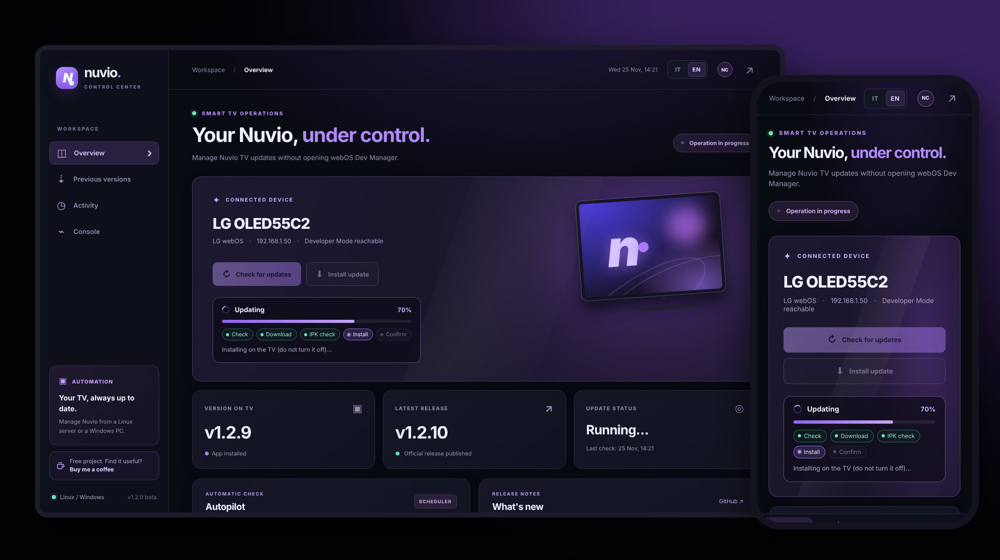
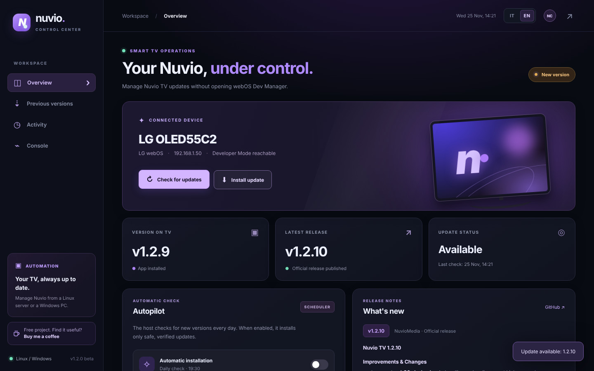
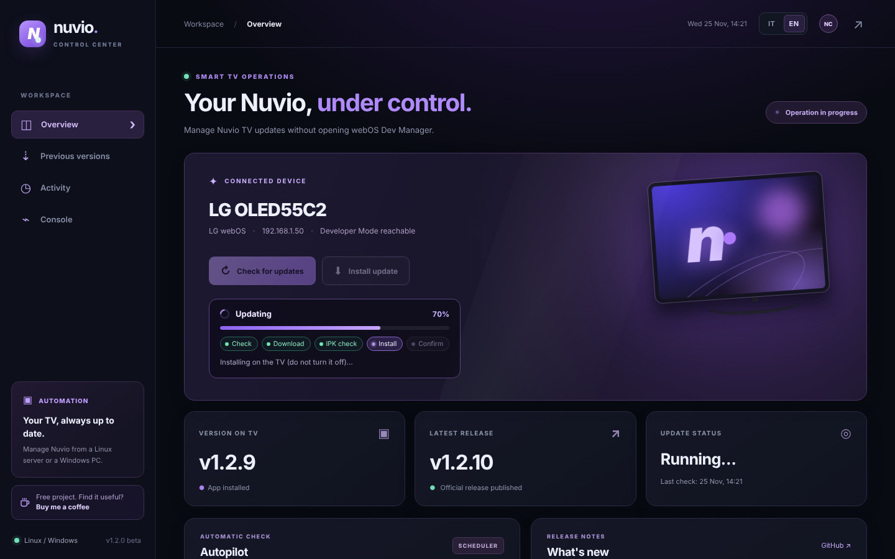
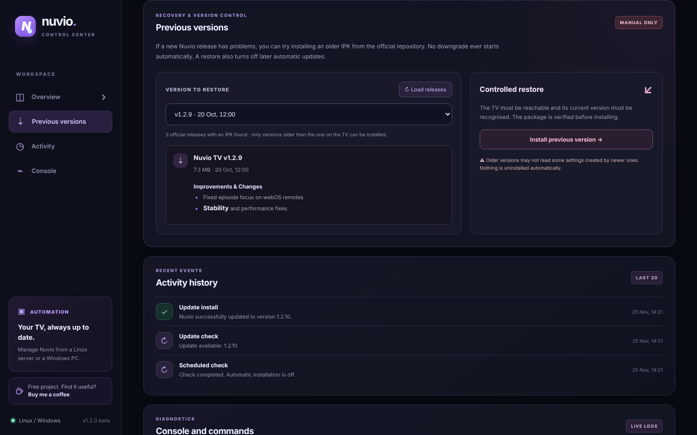
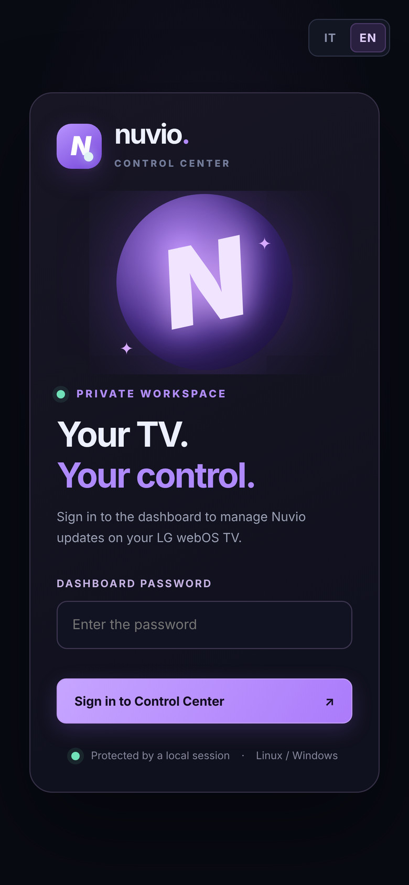
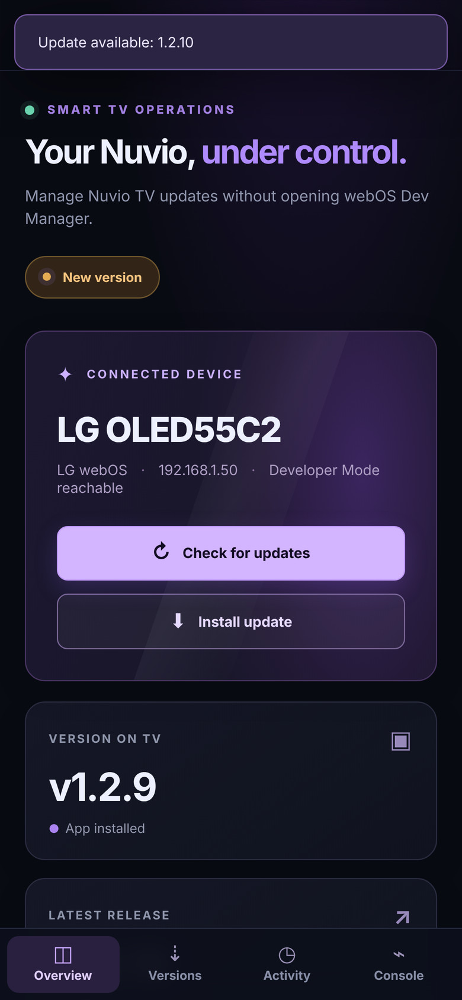
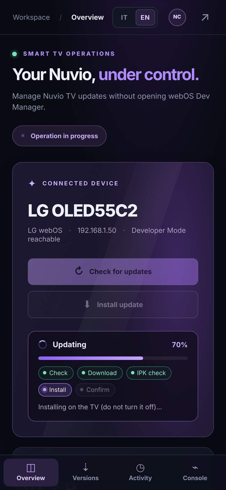
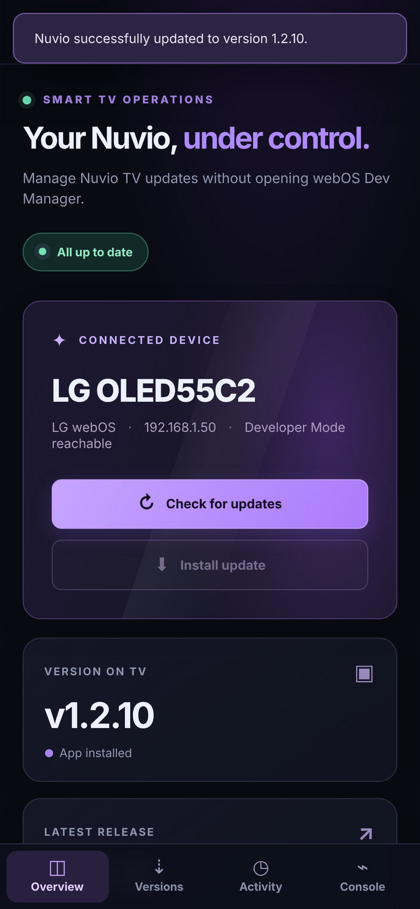

# Nuvio Control Center

**A self-hosted web dashboard for keeping Nuvio TV updated on LG webOS Developer Mode devices.**

[](https://ko-fi.com/lucairr)



[🇮🇹 Guida italiana](docs/INSTALLAZIONE_IT.md) · [🇮🇹 Pubblicazione su GitHub](docs/PUBBLICAZIONE_GITHUB_IT.md) · [Linux setup](docs/INSTALL_LINUX.md) · [Windows setup](docs/INSTALL_WINDOWS.md) · [Hardware matrix](docs/HARDWARE_COMPATIBILITY.md) · [Test plan (IT)](docs/PIANO_TEST_IT.md) · [Troubleshooting](docs/TROUBLESHOOTING.md) · [Security](SECURITY.md)

> **Community project · v1.2.0 beta · Not affiliated with NuvioMedia or LG.** This is **not** a replacement for the official [Nuvio TV Installer](https://github.com/NuvioMedia/NuvioTVSmart-Installer). The official installer handles **initial installation**. This project adds a password-protected local dashboard, scheduled release checks, and subsequent webOS updates for an existing Nuvio installation.

## Features

- **Check now** — compares the Nuvio version on your TV against the latest stable [Nuvio TV release](https://github.com/NuvioMedia/NuvioTVSmart/releases), without installing anything.
- **Install update** — installs a newer release only after validating the downloaded `.ipk` package.
- **Force reinstall** — manually reinstalls the latest release after a confirmation dialog. Never uninstalls the existing app.
- **Manual downgrade / Version history** — list eligible official stable Nuvio IPK releases, select an older version, confirm, and install in place. **Never runs automatically**; automatically turns OFF automatic updates after a requested downgrade to avoid immediately undoing it.
- **Automatic updates (opt-in)** — checks daily at 19:30 local time; installs only when enabled and the current version is identifiable.
- **Italian and English** — switch with the IT / EN buttons in the dashboard or on the sign-in page; logs, history and scheduled checks follow the same language.
- **Web UI** — responsive dark interface for PC and smartphone, login, formatted release notes, **live progress** (check → download → package check → install → confirm), TV status, history and logs.
- **Linux server / mini PC / VM** — `install.sh` creates a non-privileged system user and `systemd` services.
- **Windows PC** — double-click `install-windows.cmd`: per-user install, guided TV pairing, Task Scheduler jobs (while the user is logged in), diagnostics script.
- **No Python third-party libraries** — Python standard library only. The official LG webOS CLI needs Node.js.

## Screenshots

| Update available | Installing (live progress) | Previous versions |
| --- | --- | --- |
|  |  |  |

On a smartphone (same page, responsive, bottom navigation bar):

| Login | Update available | Installing | Up to date |
| --- | --- | --- | --- |
|  |  |  |  |

<sub>Screenshots of the real dashboard with a simulated TV (Nuvio 1.2.9 → 1.2.10), in English. The whole UI is also available in Italian (IT / EN switch at the top).</sub>

## Requirements

| Host option | Runtime requirements | Installation status |
| --- | --- | --- |
| Linux Debian 11+/Ubuntu 22.04+ with systemd (x86-64) | Python 3.9+, Node 20+, npm, LG CLI | Debian VM user-tested; other machines unverified |
| Windows 10/11 x64 | Python 3.9+, Node 20+, PowerShell 5.1+, LG CLI | Software tests only |
| Raspberry Pi 4/5 with 64-bit Raspberry Pi OS | Same as Linux | Experimental; LG CLI on ARM64 not verified |

**TV requirement (all options):** LG webOS Developer Mode + Key Server, LAN connectivity, and **Nuvio already installed** (`space.nuvio.webos`). This updater does **not** manage LG firmware; it changes the **Nuvio app version only**. See the [hardware matrix](docs/HARDWARE_COMPATIBILITY.md).

## Quick start: Linux / Debian / Ubuntu

Download the repository ZIP from GitHub (Code → Download ZIP), **extract it**, enter the directory, and run:

```bash
node -v   # Must be 20 or newer
sudo TV_IP=192.168.1.50 bash install.sh
sudo bash scripts/connect-tv-linux.sh 192.168.1.50
```

Replace `192.168.1.50` with the **TV IP shown in its Developer Mode app**. When prompted for a passphrase, type the one displayed on the TV; do not paste additional shell commands into the passphrase field. Open `http://<server-ip>:8765` on your trusted local network and use **Verifica aggiornamenti** (Check for updates).

See [complete Linux setup](docs/INSTALL_LINUX.md), including Node.js installation, upgrade/uninstall instructions and service logs.

## Quick start: Windows 10/11

1. Install [Python 3.9+](https://www.python.org/downloads/windows/) (tick **Add python.exe to PATH**) and [Node.js LTS](https://nodejs.org/).
2. Download and **extract** the ZIP, then **double-click `install-windows.cmd`**.
3. Enter the TV IP, choose a dashboard password, and let it pair the TV (type the passphrase shown on the TV).

No admin rights needed: the LG CLI is installed for your user, Task Scheduler starts the dashboard at logon and checks every day at 19:30, and a desktop shortcut opens `http://localhost:8765`. Re-pair or diagnose any time with `connect-tv-windows.ps1` / `doctor.ps1` in `%LOCALAPPDATA%\NuvioControlCenter`. Full guide: [docs/INSTALL_WINDOWS.md](docs/INSTALL_WINDOWS.md).

**No `.exe` is included.** The Windows installer is a PowerShell script; it needs local Python and Node.js.

> **Like it?** Nuvio Control Center is free and stays free. If it saves you a trip to Dev Manager at every release, [buy me a coffee on Ko-fi](https://ko-fi.com/lucairr) ☕ - it funds testing on more TVs and new features.

## Manual downgrade: Versions history

Open the dashboard, run **Verifica aggiornamenti** to identify the installed version, then open **Versioni precedenti → Carica release**, select an older eligible official stable IPK and explicitly confirm. The app verifies the download's package ID and version before invoking `ares-install`. It does not uninstall Nuvio. On a requested downgrade the system disables the automatic-install switch so the old version isn't replaced the next evening. If LG refuses the older package, the app stops and records the error; user settings may still be incompatible with an older Nuvio. **Back up settings first where possible.**

This is an **app downgrade**, not an LG/webOS firmware downgrade. Initial Nuvio installation must use official Nuvio tooling.

## How updates work

1. Query GitHub `releases/latest` for the official Nuvio webOS IPK.
2. Connect to the LG TV over the Developer Mode CLI and check `space.nuvio.webos` and its current version.
3. For automatic installation, **skip** when the TV is unreachable, Nuvio isn't installed, the version is unreadable, or the installed version is already current/newer. Manual downgrade only targets an explicitly selected older official release.
4. Download the asset over HTTPS, compare size and SHA-256 digest **when GitHub provides a digest**, and examine `appinfo.json` inside the IPK to ensure app ID and version match.
5. Install with LG `ares-install` and check the installed version again. Record logs and history. Never uninstall the app in order to force a downgrade.

> **Developer Mode can expire.** This tool does not silently bypass expiry or permanently extend Developer Mode. You may need to renew it through the LG app. IPK in-place installation normally keeps application data, but backing up your Nuvio settings before updates is recommended.

## Dashboard security

- PBKDF2-hashed local dashboard password (at least 12 characters), session cookie, CSRF protection and login rate limiting.
- Web API only exposes fixed update/check actions; **no arbitrary shell command endpoint**.
- The TV's SSH keys stay in the local profile and are **never bundled** in releases.
- On Linux systemd, the dashboard binds to `0.0.0.0:8765` for LAN access by default; on Windows it binds to `127.0.0.1:8765` unless installed with `-AllowLan`. **Never expose raw HTTP port 8765 directly to the Internet.** Use localhost, trusted LAN or an HTTPS reverse proxy / VPN when appropriate.
- On fresh installations, **automatic installation is OFF**. Periodic checks still record status.

## Repository structure

```text
nuvio/                    Python updater, authentication, cross-platform locking
web/                      Dashboard, CSS and browser JavaScript
install.sh                Linux systemd installer
uninstall.sh              Linux uninstall (keeps keys/config)
systemd/                  systemd dashboard, check and timer units
scripts/connect-tv-linux.sh  Initial Linux pairing helper
install-windows.cmd       Windows double-click installer (runs windows/install-windows.ps1)
windows/                  Windows installer, TV pairing, doctor, manual start, firewall (opt-in), uninstall
docs/                     EN + IT install, configuration and troubleshooting
tests/                    Mock tests (no TV connection)
.github/                  CI, release workflow, issue templates, FUNDING.yml
```

## Test without touching your TV

```bash
python3 -m unittest discover -s tests -v
```

On Windows, use `python -m unittest discover -s tests -v`.

## Credits & license

Independent community companion built around the **official LG webOS CLI** and official [Nuvio TV IPK releases](https://github.com/NuvioMedia/NuvioTVSmart). We do **not** redistribute the Nuvio application or claim affiliation. See [LICENSE](LICENSE) for this companion application's license; Nuvio TV itself has its [own GPL-3.0 license](https://github.com/NuvioMedia/NuvioTVSmart/blob/main/LICENSE).

**Beta testing welcome:** please include OS, Python/Node versions, CLI version, installed Nuvio version, and sanitized error logs in bug reports — **never upload `.ssh`, `auth.json`, passphrases, or real configuration files.**

## Diagnostics

```bash
# Linux (as the service user)
cd /opt/nuvio-updater && sudo -u nuvio-updater env HOME=/var/lib/nuvio-updater NUVIO_HOME=/var/lib/nuvio-updater python3 -m nuvio.server doctor
```

Windows: run `doctor.ps1` from `%LOCALAPPDATA%\NuvioControlCenter`. The report is read-only; sanitize it before posting.

## Support the project

Nuvio Control Center is free and stays free. If it saves you a trip to Dev Manager every release, you can buy me a coffee on **[Ko-fi](https://ko-fi.com/lucairr)** (also the **Sponsor** button at the top of this page). Donations are voluntary and do not unlock any feature. Please also consider [supporting the Nuvio developers](https://github.com/NuvioMedia/NuvioTVSmart), who build the app itself.

## Maintainers

Publishing and release steps (Italian): [docs/PUBBLICAZIONE_GITHUB_IT.md](docs/PUBBLICAZIONE_GITHUB_IT.md). This project deliberately does not auto-publish to your GitHub account or embed access tokens.
